# Warbound — presentationsbilder, 2026-10-16

Alla bilder är faktiska Chrome/Phaser-skärmbilder. Ingen AI-genererad bild eller retusch. Nya bilder kör aktuellt lokalt spel v0.8.0, HEAD23fe13e, med befintlig användar-CSS bevarad. Detta är lokal bildverifiering, inte ny Pages-/releaseverifiering.

## Tidigt gameplay

- 01-tidig-mvp-start.png: första kompletta spelbara MVP, Git6740128, körd igen2026-10-16 i isolerad temporär kopia. Originalets enkla rektanglar/cirklar och svenska UI är bevarade. Bilden togs inte vid den historiska committens datum.
- 02-tidig-mvp-resursinsamling.png: samma historiska version efter fysisk dragmarkering/högerklick till resursen och4,5s verklig körning.
- 02b-aldre-020-gameplay.png: original sparad browserbild från RTS-155, v0.2.0 före grafikförbättringen. Källa artifacts/rts-155/before-1280-together-movement.png. Uppställd worker/soldier-fixtur med faktisk rörelse; inte en naturlig match.

## Nuvarande gameplay

- 03-nu-gameplay-bas.png: faktisk normal matchstart på Lakehold Circuit, naturlig fog, inga tillagda enheter eller resurser.
- 04-nu-gameplay-resursinsamling.png: samma karta, fysisk markering/högerklick till trä och12s verklig körning. Ingen snabb simulering.

## Faktiska enheter och byggnader

asset-units-player/enemy.png och asset-buildings-player/enemy.png visar fem rasers faktiska laddade runtime-sprites i Phaser. Uppställda testgallerier, inte gameplay. Skala1:1. Kolumner enheter: worker, soldier, archer, specialist, catapult, air, warship, transport. Byggnader: base, barracks, farm, forge, harbor, tower, academy, wall, gate. Rader: Human, Orcs, Elves, Dwarves, Goblins. Befintligt galleri kontrollerade även samtliga runtime-frame-referenser i units/naval/buildings/air utan saknade frames. Minimap gömd i galleribilderna för att inte skymma sprites. Galleriurvalet täcker inte hela avancerade rostern.

## Detaljerade kartor

Lakehold Circuit64×64, Five Passes96×96 och River Crown128×128. karta-*-fog.png och karta-*-utan-fog.png är par från exakt samma frysta match och kameravinkel. Fogbilden visar verklig startsikt; andra bilden sätter visible/explored till true för alla lag. Full sikt är en uttrycklig testfixtur, inte naturlig utforskning. Kartorna använder översiktszoom. detalj-*-utan-fog.png visar terräng vid zoom1. Bilderna är1920×1080.

## Verifiering

Nya kart-/gameplaykörningar och assetgallerier avslutade utan browser-runtimefel. Kartbilder, historisk MVP, gameplay och representativa assetbilder visuellt granskade. Ingen spelkod ändrad; ingen ny unit/build/fullregression eller mänskligt balans-/ljudtest kördes. Reproducerbara capture-script bifogade; de använder lokal extern Playwright/Chrome och Vite5198/5199. capture.json innehåller kartornas runtimeuppgifter. Scriptens lokala absoluta sökvägar behöver anpassas på annan dator.

## Bildöversikt

### 01-tidig-mvp-start

[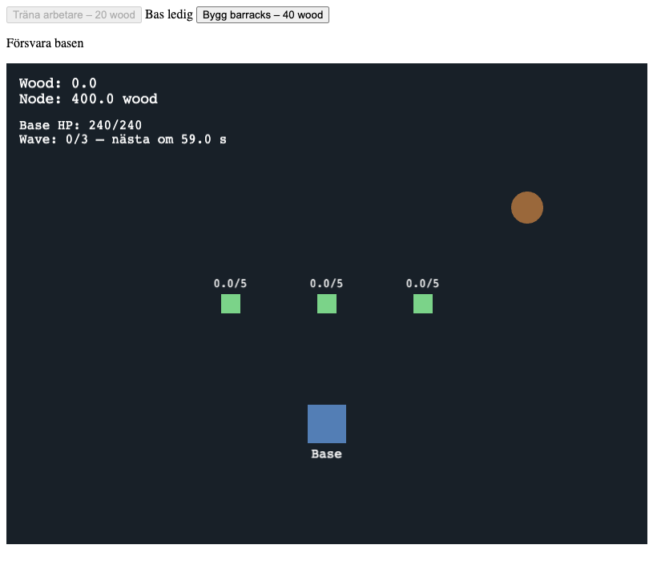](01-tidig-mvp-start.png)

### 02-tidig-mvp-resursinsamling

[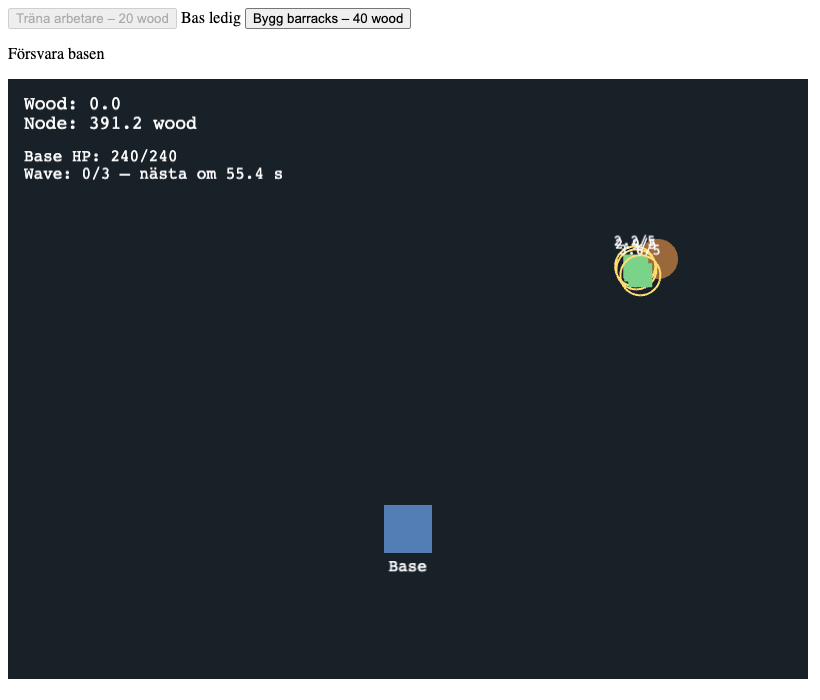](02-tidig-mvp-resursinsamling.png)

### 02b-aldre-020-gameplay

[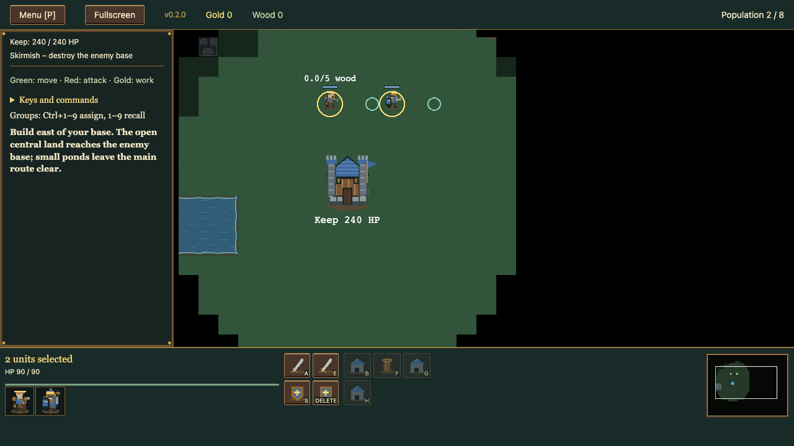](02b-aldre-020-gameplay.png)

### 03-nu-gameplay-bas

[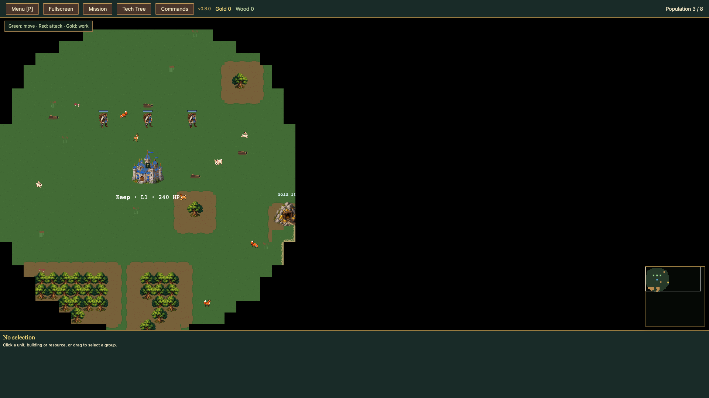](03-nu-gameplay-bas.png)

### 04-nu-gameplay-resursinsamling

[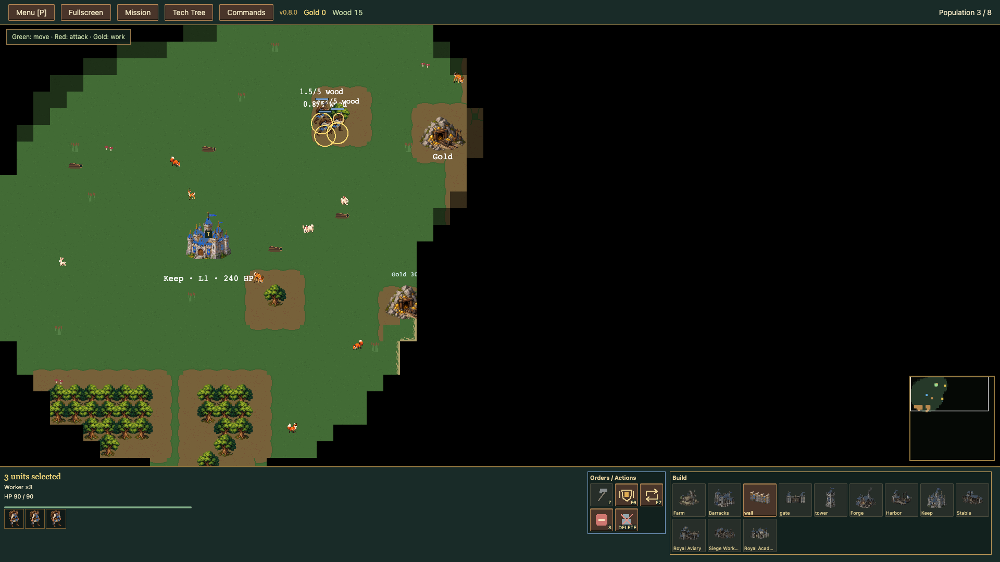](04-nu-gameplay-resursinsamling.png)

### asset-buildings-enemy

[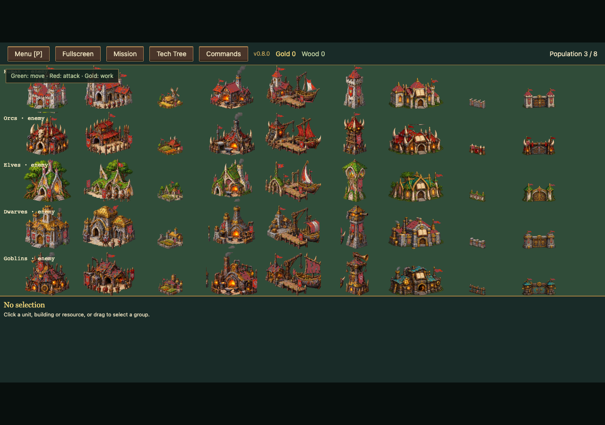](asset-buildings-enemy.png)

### asset-buildings-player

[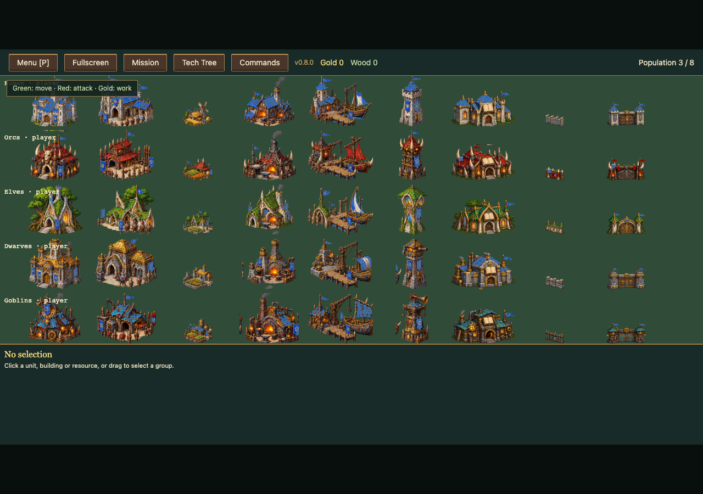](asset-buildings-player.png)

### asset-units-enemy

[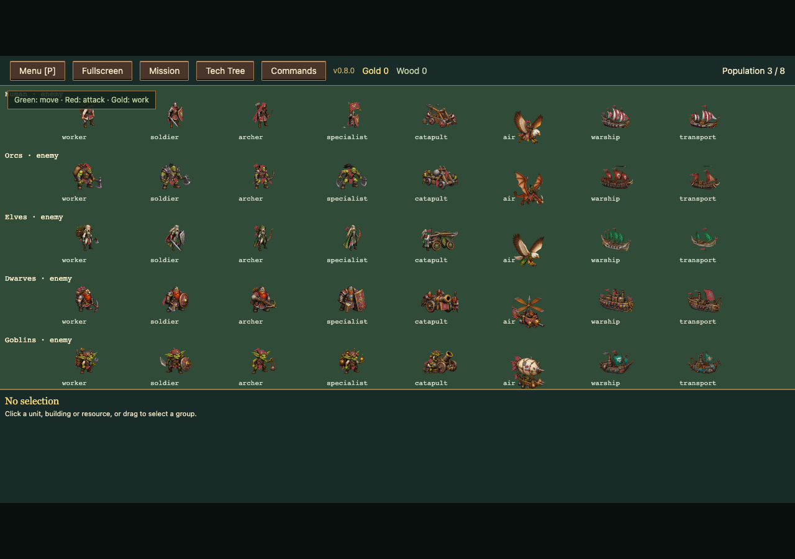](asset-units-enemy.png)

### asset-units-player

[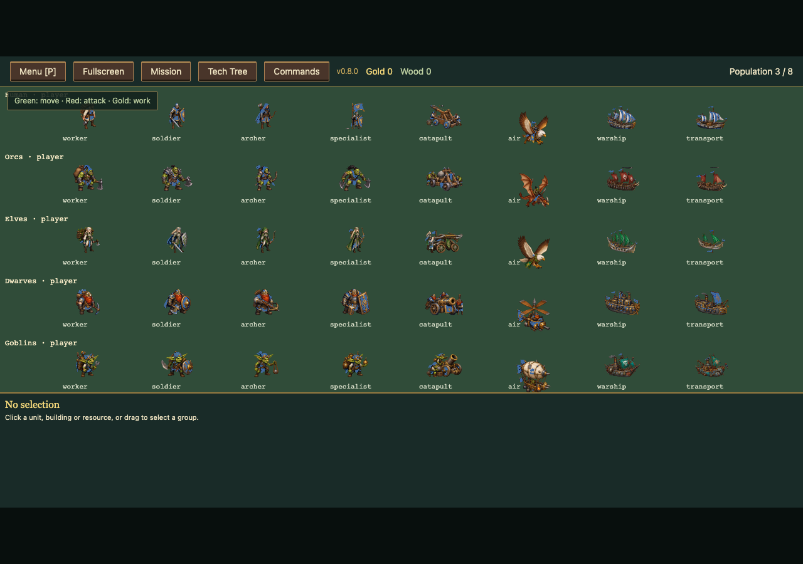](asset-units-player.png)

### detalj-lakehold-utan-fog

[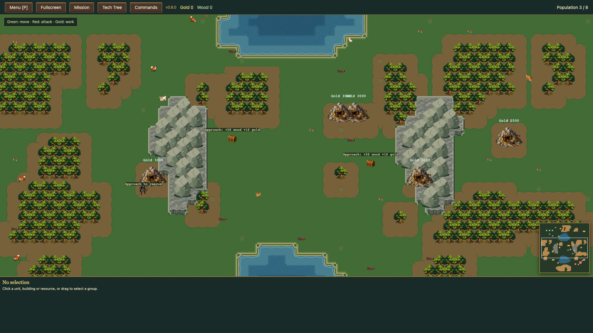](detalj-lakehold-utan-fog.png)

### detalj-rivercrown-utan-fog

[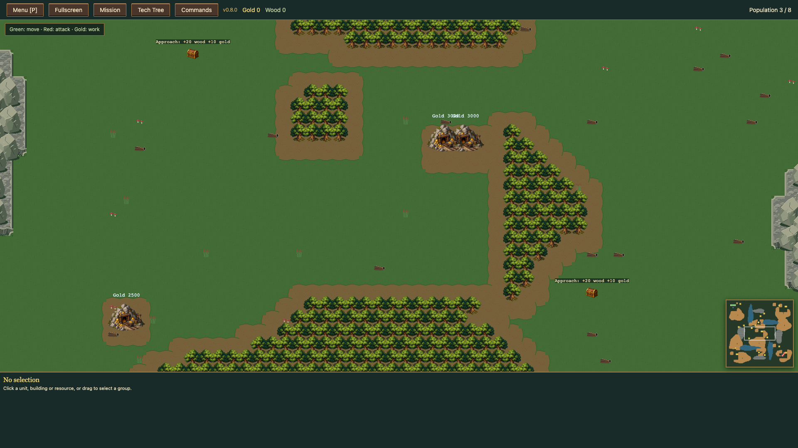](detalj-rivercrown-utan-fog.png)

### karta-fivepasses-fog

[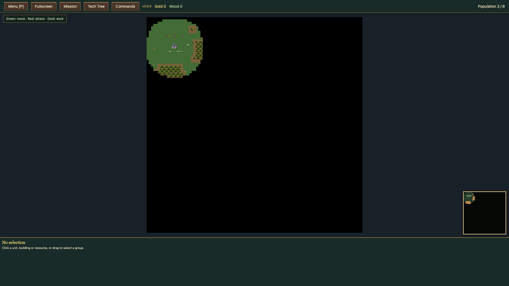](karta-fivepasses-fog.png)

### karta-fivepasses-utan-fog

[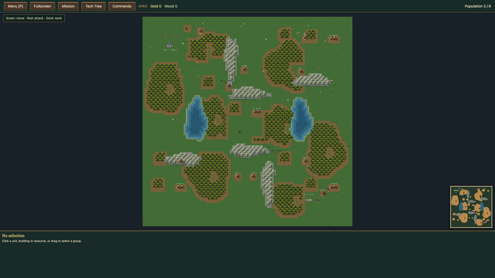](karta-fivepasses-utan-fog.png)

### karta-lakehold-fog

[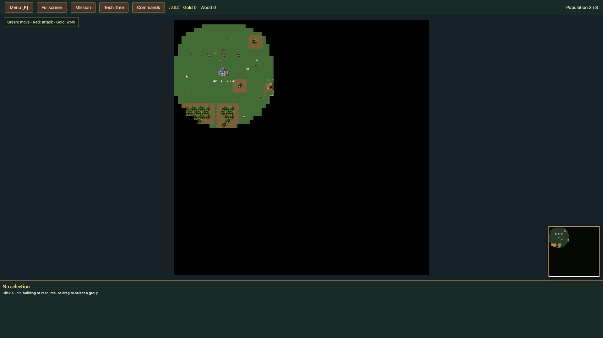](karta-lakehold-fog.png)

### karta-lakehold-utan-fog

[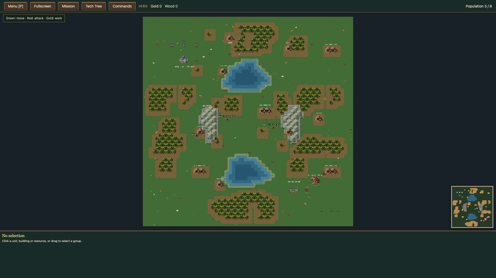](karta-lakehold-utan-fog.png)

### karta-rivercrown-fog

[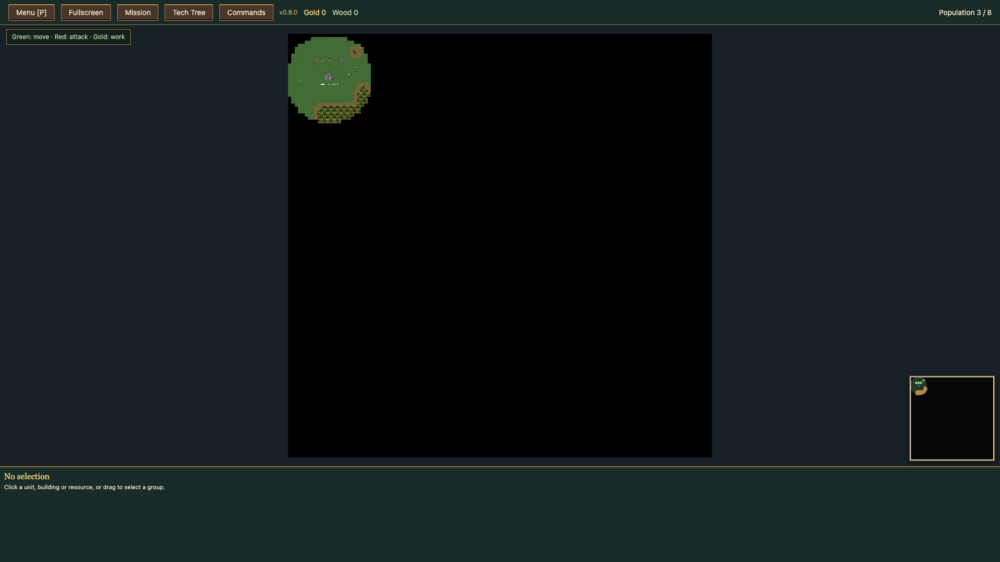](karta-rivercrown-fog.png)

### karta-rivercrown-utan-fog

[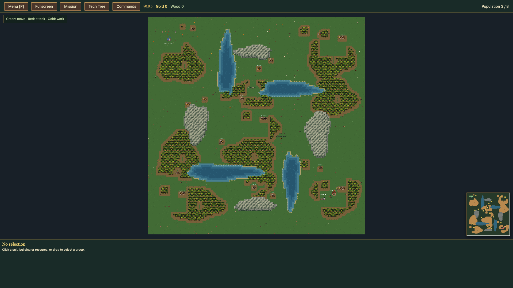](karta-rivercrown-utan-fog.png)
