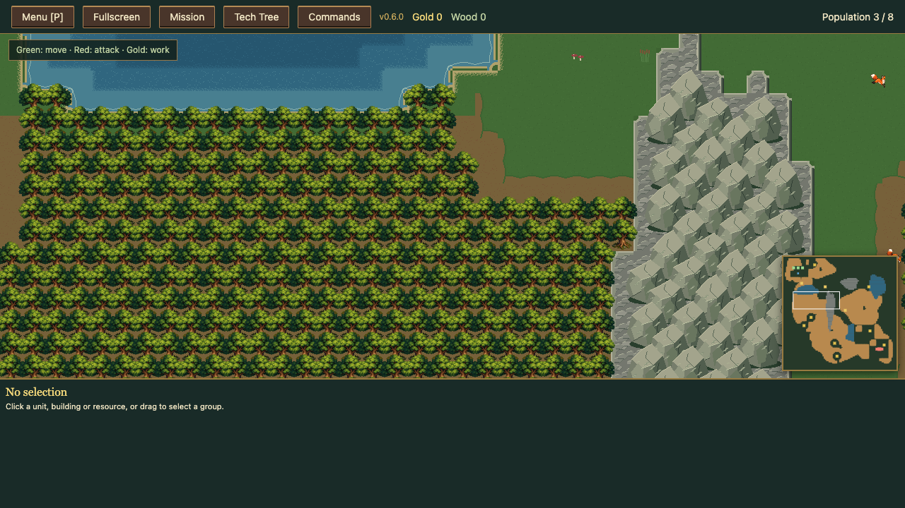
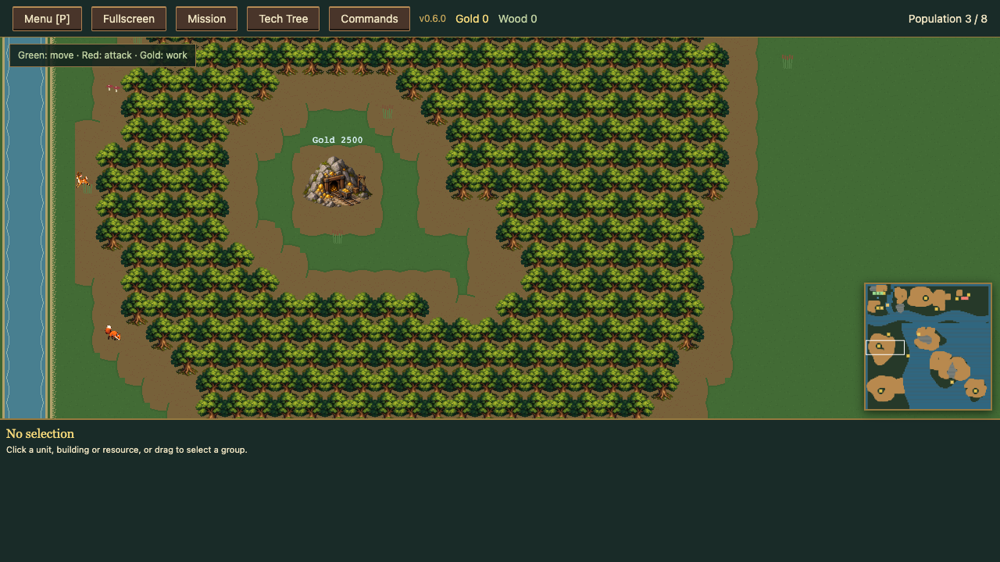
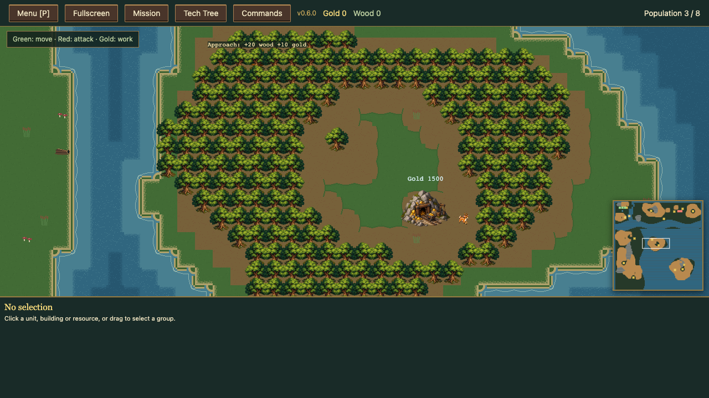

# RTS-244 — Renderade kartor

Nya matcher använder woodlands. Sparade regions-/organic-/classic-kartor bevaras.
Översikterna visar verklig renderer med explicit fullt avslöjad art-fixture; ingen naturlig utforsknings- eller balansclaim.

| Karta | Träd före → efter | Största skog före → efter | Gruvor före → efter | Browser |
|---|---:|---:|---:|---|
| coast | 657 → 2145 | 202 → 468 | 8 → 12 | [Översikt](coast-overview.png) |
| highlands | 1149 → 2966 | 314 → 907 | 7 → 13 | [Översikt](highlands-overview.png) |
| plains96 | 1685 → 3602 | 399 → 1043 | 7 → 11 | [Översikt](plains96-overview.png) |
| plains128 | 1923 → 4153 | 492 → 1425 | 8 → 11 | [Översikt](plains128-overview.png) |
| frontier | 2248 → 3926 | 479 → 1568 | 4 → 12 | [Översikt](frontier-overview.png) |
| arena | 416 → 870 | 100 → 317 | 4 → 5 | [Översikt](arena-overview.png) |
| forest | 1295 → 2558 | 395 → 1386 | 4 → 8 | [Översikt](forest-overview.png) |
| islands | 557 → 2536 | 164 → 520 | 5 → 11 | [Översikt](islands-overview.png) |
| river | 1761 → 3519 | 477 → 985 | 6 → 12 | [Översikt](river-overview.png) |

## forest — närbild

## islands — närbild

## coast — närbild

Navigation: alla inlandskartor har markrutt till huvudbas. Islands/Coast kräver sjötransport; specifika landstignings- och vattenrutter verifieras i mapRegions/campaignPhases. Alla gamla guldplatser bevarade. Nya grovor hålls utanför start-/AI-expansionszoner.
Faktisk worker-avverkning öppnar en ny fysisk skogscell och sparas. Renderade nio översikter och tre representativa närbilder visuellt granskade.
Kampanjen har fortfarande åtta uppdrags-ID:n per fem rasvarianter; utökningen görs separat247–248.
